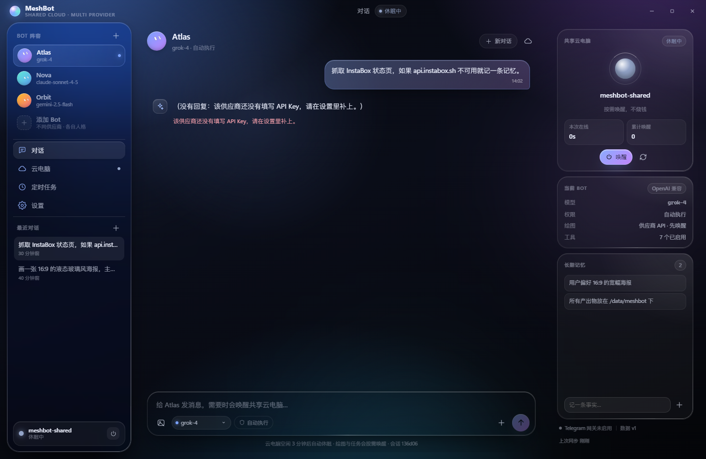
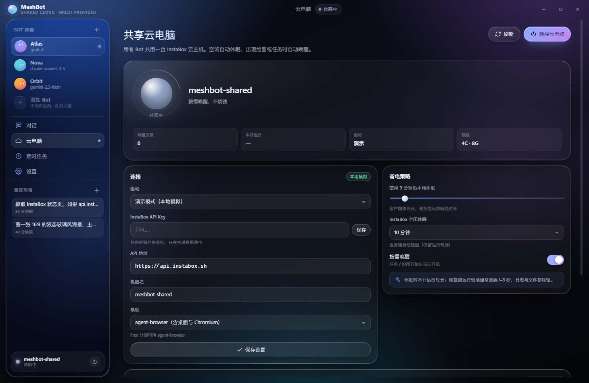
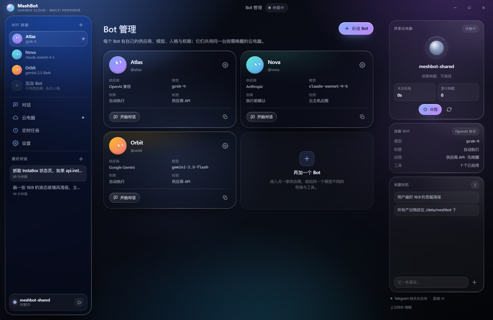
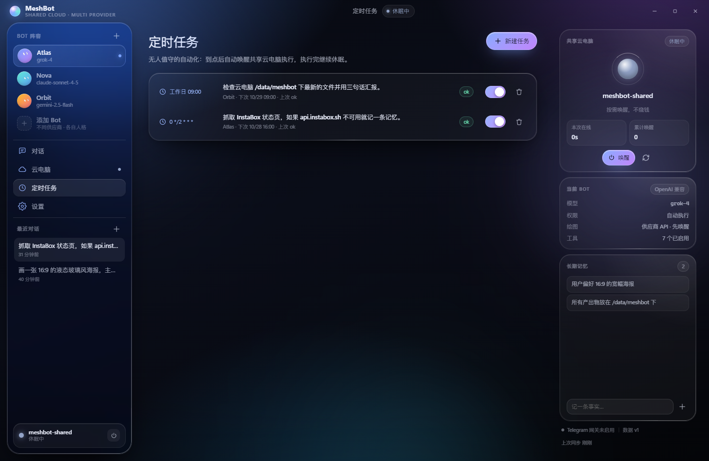
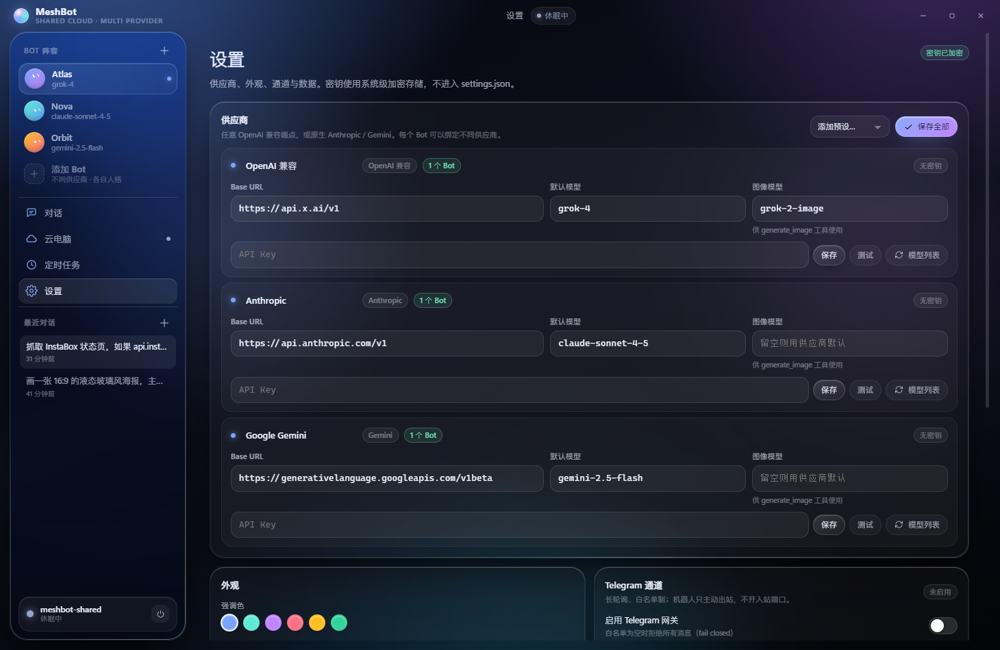

# MeshBot

> 多个 Bot 共用一台「睡着了」的云电脑 —— 需要时唤醒，干完活继续睡。
> Multi-provider bot workforce on one on-demand cloud computer. Liquid-glass desktop UI.

MeshBot 是一个开源的桌面 Agent 客户端，形态参考 Grok Bot：本地运行的 Agent 循环、可自定义接入任意大模型供应商、长期记忆、定时任务、Telegram 远程通道、工具审批。
区别在于它把「执行环境」交给一台按需唤醒的云主机（默认接入 [InstaBox](https://instabox.sh)）：平时挂起不烧钱，只有真正要跑命令或画图时才开机，任务结束自动休眠。

```
┌──────────── MeshBot 桌面端 (Electron + React) ────────────┐
│  会话 / Bot 阵容 / 云电脑 / 定时任务 / 设置                │
│                                                            │
│  Agent 循环 ── 工具调用 ── 审批 ── 记忆 ── 定时器           │
│      │                                                     │
│      ├── 供应商适配器  OpenAI 兼容 · Anthropic · Gemini      │
│      └── CloudHost ── InstaBoxDriver / MockDriver          │
└────────────────────────────┬───────────────────────────────┘
                             │ x-api-key
                    ┌────────▼────────┐
                    │  InstaBox 云主机 │  4 vCPU / 8GB · /data
                    │  挂起 ↔ 唤醒      │  autoSuspend 自动休眠
                    └─────────────────┘
```

## 截图

| 对话 | 共享云电脑 |
| --- | --- |
|  |  |

| Bot 管理 | 定时任务 |
| --- | --- |
|  |  |



## 特性

**多供应商，一个界面改完**
xAI Grok、OpenAI、Anthropic、Google Gemini、DeepSeek、OpenRouter、阿里云百炼、Moonshot、本地 Ollama，以及任意 OpenAI 兼容端点。每个 Bot 独立绑定供应商与模型，API Key 用系统级加密（Electron `safeStorage`）单独存进 `secrets.bin.json`，不会落进可读的 `settings.json`。

**共享云电脑 + 按需唤醒**
所有 Bot 共用一台云主机。纯聊天不会唤醒它；只有当 Agent 真的调用 `cloud_exec` / `cloud_read` / `cloud_write`，或者要出图时，才 `wake` 一次。工作区 `/data/meshbot` 持久保留，休眠不丢文件。本地空闲计时器（默认 3 分钟）和服务端 `autoSuspendAfterSeconds` 双重兜底，避免忘关烧配额。

**真正的 Agent 循环**
最多 14 步的工具链：执行命令、读文件、写文件、生成图片、写入记忆、召回记忆、创建定时任务、抓网页。可配置「自动执行 / 每步审批」，审批请求以玻璃弹层形式阻塞在界面上，也可以从 Telegram 远程批准。

**长期记忆 + 定时任务**
记忆按 Bot 隔离、去重后注入系统提示；定时任务用 5 段 cron 表达式，到点无人值守跑一轮（`runUnattended`），跑完可以继续休眠。

**Telegram 网关**
长轮询、机器人主动外连、不开入站端口；白名单为空时拒绝一切消息（fail closed）。

**液态玻璃 UI**
分层渐变、`backdrop-filter: blur(32px) saturate(165%)`、conic-gradient 1px 描边、极光光斑、颗粒噪点、跟随光标的辉光。可调强调色、明暗主题、玻璃浓度、密度，也能一键关掉动效。

## 快速开始

```bash
pnpm install
pnpm dev          # 自动先编译 core，再启动 Vite + Electron
```

首次启动没有配置密钥时会进入「演示模式」：`MockDriver` 在本地模拟 InstaBox 的挂起/唤醒状态机，出图用占位 SVG，所有界面与流程都能走通。

配置真实环境：

1. 设置 → 添加供应商 → 填 Base URL / 模型 / API Key → 保存 → 点「测试」。
2. 设置 → 云电脑 → 填 InstaBox API Key（控制台获取）→ 保存 → 「刷新」拿到机器列表。
3. Bot 阵容 → 给每个 Bot 选供应商、模型、权限与工具。

## 常用命令

| 命令 | 说明 |
| --- | --- |
| `pnpm dev` | 编译 core 并启动开发模式（Vite HMR + Electron） |
| `pnpm dev:core` | 只监听编译 `@mesh/core`（改了 core 时另开一个终端） |
| `pnpm build` | 编译 core + 桌面端产物 |
| `pnpm typecheck` | 全仓库类型检查 |
| `pnpm smoke` | 起一个假的 OpenAI SSE 服务，跑通「唤云 → 工具调用 → 出图 → 落盘 → 二次回复」 |
| `pnpm seed` | 写入演示用 Bot / 供应商 / 定时任务 / 记忆 |
| `pnpm dist` | 打 Windows NSIS 安装包到 `apps/desktop/release` |

## 目录结构

```
apps/desktop             Electron 主进程 + React 渲染层
  electron/              main / preload / app（全部 mesh:* IPC）
  src/                   views、components、state、liquid.css 设计系统
packages/core            与 UI 无关的纯逻辑，编译成 CJS 供主进程引用
  src/providers/         OpenAI 兼容 / Anthropic / Gemini 适配器
  src/agent.ts           Agent 循环（工具编排、审批、事件流）
  src/cloud.ts           CloudHost 编排 + InstaBoxDriver + MockDriver
  src/instabox.ts        InstaBox HTTP 客户端（生命周期、SSE exec、文件读写）
  src/tools.ts           工具 schema 与实现
  src/store.ts           settings / 会话 / 记忆 / 定时任务持久化
  src/scheduler.ts       cron 解析与调度器
  src/telegram.ts        Telegram 长轮询网关
scripts/                 smoke 测试与演示数据脚本
```

更细的模块划分见 [docs/ARCHITECTURE.md](docs/ARCHITECTURE.md)，后续计划见 [docs/ROADMAP.md](docs/ROADMAP.md)。

## 数据存放

默认在用户数据目录下（可用 `MESH_DATA_DIR` 覆盖，便于便携部署与测试）：

```
settings.json          设置（不含密钥）
secrets.bin.json       safeStorage 加密后的密钥
conversations/*.json   会话与消息
memories.json          长期记忆
schedules.json         定时任务
artifacts/             生成图片等产物（mesh-asset:// 协议读取）
```

## InstaBox 说明

MeshBot 用到的接口：`POST /v1/machines/{id}/wake`（唤醒，直接返回机器）、`PATCH /v1/machines/{id}`（`autoSuspendAfterSeconds`，付费档 300–1800 秒）、`POST /v1/machines/{id}/exec`（`Accept: text/event-stream` 流式 stdout/stderr/exit）、`PUT/GET .../files`（原始字节读写）。异步生命周期操作返回 `202` + operation id，客户端会轮询 `GET /v1/operations/{id}?wait=25s`。

## 关于名字

根目录 `package.json` 里仍叫 `meshbots`（历史包名），产品名一律 MeshBot。

## 素材引用

**Bot 头像**（界面里那些带多边形眼睛的团子）使用了社区复刻项目的角色几何：

- [blessonism/grok-icon-study](https://github.com/blessonism/grok-icon-study) —— 对 Grok Bot.app v0.18.0 登录页角色动效的学习复刻
- 用到的数据：`replica/geometry-data.js` 中的身体轮廓 `blobPath` 与 idle 眼睛 `eyes[0]`，提炼成 `apps/desktop/src/assets/grok/avatar-geometry.json`（2.1 KB）；各 Bot 的神情由渲染层对这同一组眼睛做刚体变换得到
- 角色设计归 **xAI** 所有，上游仓库声明「仅供学习参考，请勿商用或再分发」，且**没有 LICENSE 文件**

因此这份素材在本仓库里是**受限制的第三方内容，不是 MIT 的一部分**：只有 MeshBot 自研的代码与文档适用 MIT，角色几何与造型权利仍归 xAI / 相应权利人。完整说明（授权状态、如何一行关掉它、如何重新生成）见 [docs/ASSETS.md](docs/ASSETS.md)。

```bash
# 只重新生成头像几何（需先自行下载上游 geometry-data.js）
node scripts/build-avatar-geometry.mjs
```

想去掉这套角色素材：把 [apps/desktop/src/assets/grok/geometry.ts](apps/desktop/src/assets/grok/geometry.ts) 里的 `GROK_AVATAR` 改成 `null`，界面自动回落到「渐变底 + 首字母」头像，其余代码无需改动。

## License

MIT
