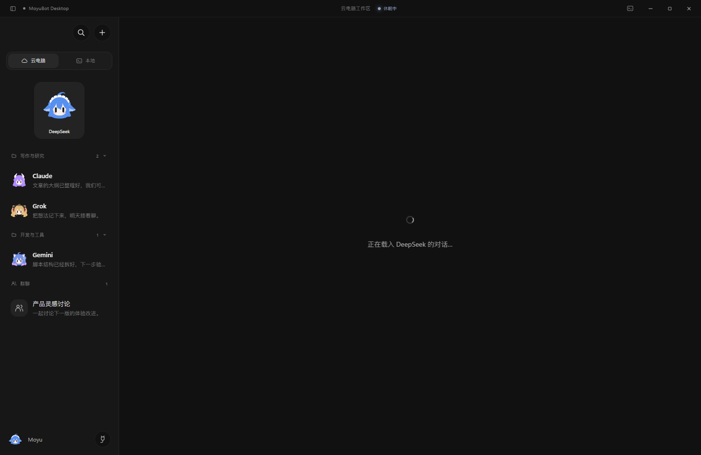
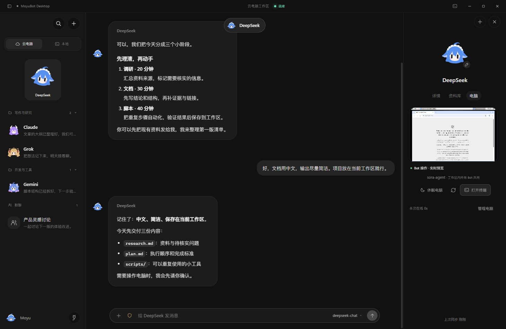
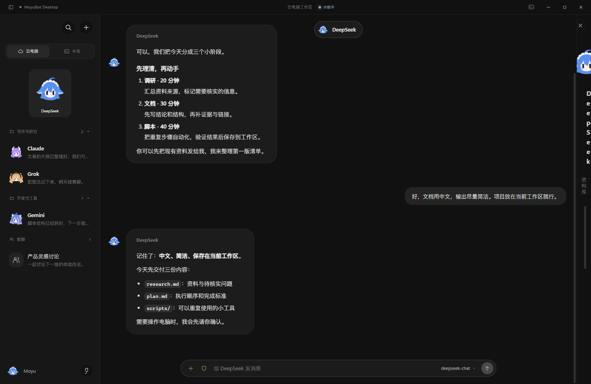
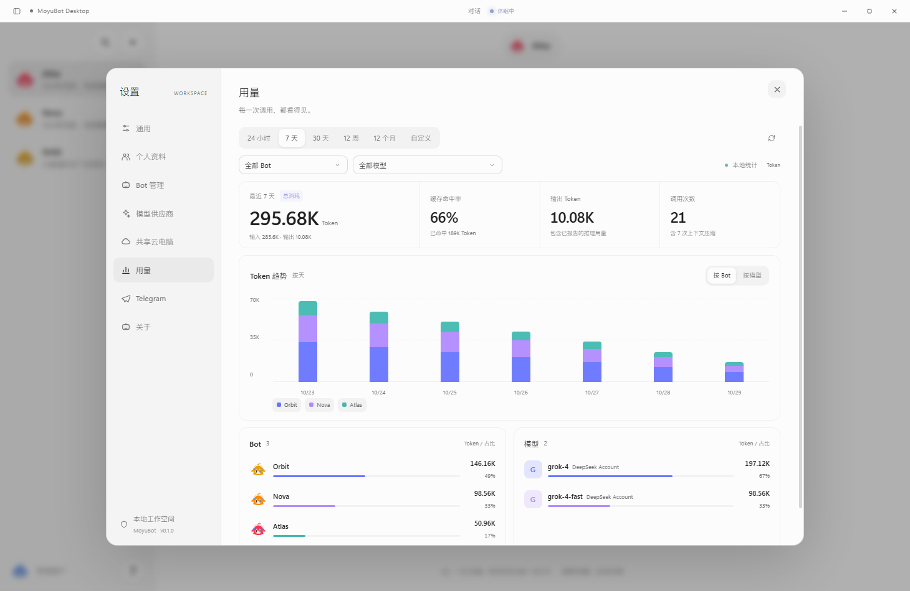

<p align="center">
  
</p>

<h1 align="center">MoyuBot</h1>

<p align="center">
  你的摸鱼 AI 工作空间<br />
  多个 Bot，一台共享电脑。需要时唤醒，干完活继续睡。
</p>

<p align="center">
  <a href="https://github.com/whitemoono/moyubot/releases/latest">下载 Windows 版</a> ·
  <a href="#截图">界面预览</a> ·
  <a href="#快速开始">快速开始</a> ·
  <a href="#开发者">认识开发者</a>
</p>

<p align="center">
  <a href="https://x.com/sora_to21">X / Twitter · @sora_to21</a> &nbsp; / &nbsp;
  <a href="https://space.bilibili.com/131577226">bilibili</a> &nbsp; / &nbsp;
  <a href="https://t.me/chisakuu">Telegram · @chisakuu</a>
</p>

---

MoyuBot 是一个开源的桌面 Agent 客户端，形态参考 Grok Bot：本地运行的 Agent 循环、可自定义接入任意大模型供应商、长期记忆、定时任务、工具审批。
区别在于它把「执行环境」交给一台按需唤醒的云主机（默认接入 [InstaBox](https://instabox.sh)）：平时挂起不烧钱，只有真正要跑命令或画图时才开机，任务结束自动休眠。

```
┌──────────── MoyuBot 桌面端 (Electron + React) ────────────┐
│  会话 / Bot 阵容 / 云电脑 / 用量 / 设置                    │
│                                                            │
│  Agent 循环 ── 工具调用 ── 审批 ── 记忆 ── 定时器           │
│      │                                                     │
│      ├── 供应商适配器  OpenAI 兼容 · Anthropic · Gemini      │
│      └── CloudHost ── InstaBoxDriver / MockDriver          │
└────────────────────────────┬───────────────────────────────┘
                             │ x-api-key
                    ┌────────▼────────┐
                    │  InstaBox 云主机 │  4 vCPU / 8GB · /data
                    │  挂起 ↔ 唤醒      │  autoSuspend 自动休眠
                    └─────────────────┘
```

## 截图

以下为 v0.1.0 当前界面实拍，统一使用演示账号与示例对话；Token 用量为演示数据，云桌面为实际 InstaBox 连接。



| 持续对话 · 悬浮输入框 | 云电脑 · 实时桌面预览 |
| --- | --- |
|  |  |

| 模型供应商 · 官方服务与自定义中转 | Token 用量 · 按 Bot 和模型统计 |
| --- | --- |
|  |  |


更多界面：[浅色主题](docs/screenshots/home-light.png) · [Bot 管理](docs/screenshots/bots.png) · [长期记忆资料库](docs/screenshots/library.png) · [云电脑连接与休眠策略](docs/screenshots/cloud.png) · [放大远程桌面与接管入口](docs/screenshots/cloud-desktop-expanded.png)

右侧面板以 Bot 头像和名称为中心，分为「详情 / 资料库 / 电脑」三个页签：分别查看角色设定与上下文摘要、管理长期记忆与对话文件，以及查看电脑状态并唤醒或休眠。

右侧栏顶部的「＋」直接打开创建弹窗，可填写名字、选择 7 套角色头像及主题色。头像使用本地提供的 `ai girl bot` 素材，默认 DeepSeek；新 Bot 默认接入 `deepseek-chat`，创建后可在 Bot 管理中配置 API Key 或切换模型。取消弹窗不新增 Bot 或供应商。

回复前显示当前 Bot 的头像，实时动作随思考、搜索、工具执行、写作、出图、记忆、授权等待、完成和错误等状态切换。旧消息使用静态头像，减少动效设置也会生效；具体规则见 [头像状态设计](docs/BOT-ACTIVITY.md)。

## 特性

**多供应商，一个界面改完**
xAI Grok、OpenAI、Anthropic、Google Gemini、DeepSeek、OpenRouter、阿里云百炼、Moonshot、本地 Ollama，以及任意 OpenAI 兼容端点。每个 Bot 独立绑定供应商与模型，API Key 用系统级加密（Electron `safeStorage`）单独存进 `secrets.bin.json`，不会落进可读的 `settings.json`。

设置以独立弹窗打开，左侧切换分类，保留背后的聊天与输入草稿。供应商采用列表与详情布局，支持搜索、重复添加独立实例，以及第三方中转站的自定义地址和 OpenAI / Anthropic / Gemini 协议选择。模型可以获取、筛选或手动添加；测试连接与获取模型使用当前草稿及临时密钥，不会自动覆盖已保存配置。保存后清空密钥输入，留空保留原密钥；关闭时提醒未保存的更改。通用、个人资料、关于以及 Bot、云电脑、任务页面共用紧凑的输入与下拉控件，支持明暗主题、键盘选择和减少动效。

**共享云电脑 + 按需唤醒**
所有 Bot 共用一台云主机。纯聊天不会唤醒它；只有当 Agent 真的调用 `cloud_exec` / `cloud_read` / `cloud_write`，或者要出图时，才 `wake` 一次。工作区 `/data/moyubot` 持久保留，休眠不丢文件。本地空闲计时器（默认 3 分钟）和服务端 `autoSuspendAfterSeconds` 双重兜底，避免忘关烧配额。

「Bot 管理」与「共享云电脑」均整合进设置弹窗，头像菜单、搜索和顶部状态入口会打开对应分类。编辑 Bot 后留在管理页，点击开始对话则返回聊天。云电脑页用状态卡展示环境、运行时长和唤醒次数，下方并排管理连接与休眠策略；终端独立成页签，保存按钮固定在底部。配置草稿会在分类切换时保留，关闭前提示未保存更改；API Key 留空保留原密钥。唤醒、休眠、状态刷新和命令执行仍使用原有云电脑接口。

头像菜单采用紧凑单行列表，移除定时任务入口，新增「用量」，直接打开设置内的 Token 仪表盘。支持最近 24 小时、7 天、30 天、12 周、12 个月以及自定义日期（本地时间，包含起止日），可按 Bot 和供应商模型筛选、切换堆叠趋势，并点击排行继续筛选。指标包含输入与输出 Token、缓存命中率、调用次数；数字、柱图与排行进度条使用轻量动效，遵循减少动效设置。

用量由每次模型请求独立记账到本地 `usage.jsonl`，包含工具链中各次请求、群聊实际发言成员及自动上下文压缩，不包含图片生成或供应商连接测试。不保存消息正文或密钥。仅显示供应商实际报告的 Token；缺少完整用量的请求会注明，缓存未报告时显示「—」，部分缓存数据的命中率仅基于已报告请求。历史消息只回填已保存的用量，旧版多步调用可能不完整，重启不会重复计数。同名模型按供应商实例区分。通过 `pnpm test:usage` 验证记录、协议适配、时间边界、历史去重和运行时归属。

**真正的 Agent 循环**
最多 14 步的工具链：执行命令、读文件、写文件、生成图片、写入记忆、召回记忆、创建定时任务、抓网页。可配置「自动执行 / 每步审批」，审批请求以玻璃弹层形式阻塞在界面上。

**长期记忆 + 定时任务**
记忆按 Bot 隔离、去重后注入系统提示。定时任务直接在聊天中管理，例如「每 30 分钟检查一次项目」「明天下午 4 点提醒我」「把晨报改到 10 点」「暂停／恢复／关闭这个任务」。当前 Bot 的「详情 → 例行任务」实时显示紧凑任务列表，包含周期或一次性时间、快捷开关、展开后的完整指令与最近结果；关闭和完成的任务保留在可折叠的历史区，无任务时不显示占位列表。启用定时任务工具的旧 Bot 自动获得查询、修改和启停能力。任务不跨 Bot 操作；时间或目标不明确时应先补充确认，工具成功后才能确认已安排。

重复任务使用本地时区的 5 段 cron，一次性任务保存含时区的绝对时间。本地调度每 30 秒检查，需保持应用运行；到点在同一个 Bot 对话执行并汇报，需要云电脑时按需唤醒。Bot 正在回复时任务等待，同一任务不重叠执行；暂停与关闭停止后续安排，已开始的本次执行会继续。恢复重复任务会重新计算未来时间，不补跑暂停期间的任务。一次性任务执行后自动结束；若运行时退出应用，重启后标记中断并保留记录，避免自动重复执行可能已产生结果的操作。执行失败会保留错误信息，只有最终回复完成才标记成功。通过 `pnpm test:schedules` 验证聊天工具、时间校验、Bot 隔离、状态持久化与调度行为。

关于页展示 App 图标、实际版本、GitHub 仓库地址、复制与外部链接。手动检查 GitHub 正式发行版，区分新版、当前版本、未发布和连接失败；有新版时打开对应发行页查看与下载。桌面端已移除 Telegram 设置与后台连接。

**一个 Bot，一个持续对话**
切换 Bot 就回到它自己的固定对话，搜索弹窗里的「新对话」用于选择 Bot，继续该 Bot 的聊天，不会清空或另建私聊。桌面端和定时任务共用该 Bot 的同一份上下文。已有多个会话会按时间合并，旧会话文件保留并标记归档，不删除消息。

搜索弹窗先显示已创建的 Bot（包含隐藏的 Bot）与群聊，再显示「新对话、创建 Bot、新建群聊、Bot 设置」四个功能。输入可筛选名字和最近消息预览，支持上下方向键、Enter、Esc、点击遮罩关闭，以及焦点约束。创建 Bot 打开原有角色配置弹窗；Bot 设置进入管理页。

**多个 Bot 参与群聊**
从搜索弹窗发起群聊，选择 2–12 个 Bot 并填写可选群名。每条用户消息发送一次，成员按选择顺序依次流式回复，显示各自的头像和名字；后续成员可参考前面的发言。停止会取消当前回复及后续排队的成员。各成员继续使用自己的模型、工具与审批配置；群聊消息、上下文压缩和自动记忆独立保存，不注入 Bot 的私聊历史与私聊记忆。群聊会显示在侧栏，可搜索，重启后恢复；顶部胶囊可查看成员及顺序。某成员被删除后跳过该成员，原群消息保留。

左侧 Bot 支持右键菜单：置顶、分组、标为未读、重命名、复制对话 ID、隐藏及删除。置顶时，列表卡片收缩并弹到顶部，其他行平滑回弹；未置顶时不显示占位区域。置顶支持多个，取消置顶会回到原分组。隐藏的 Bot 收进列表下方可折叠的「已隐藏的 Bot」，仍可打开聊天，右键「取消隐藏」恢复；「Bot 管理」也保留恢复入口。分组、隐藏与置顶偏好保存在本地；减少动效时跳过位移动画。删除前会再次确认，本地对话与记忆保留。

点击分组标题可折叠或展开，折叠状态和分组排列会在重启后保留。右键分组标题可重命名、上移、下移或删除，首尾位置自动禁用对应方向；重命名同步更新隐藏及置顶的成员，删除仅把成员移回「未分组」。收起整个侧栏时仍显示 Bot 头像，有置顶 Bot 时在置顶区下方显示细分割线；取消最后一个置顶后分割线一并移除。

有消息后，输入框收为悬浮的单行胶囊，外层透明，聊天内容可以从周围滚过。多行输入及图片附件会自动展开，底部留白随输入框高度调整；模型与权限在右侧的对话选项中。

接近上下文上限时，自动调用当前 Bot 的模型分批压缩较早内容，保留决定、约束与待办，并把稳定偏好和长期事项提炼成去重后的长期记忆。摘要持久保存；完整消息留在本地，重启后继续使用。压缩失败或被停止时不推进摘要进度。供应商设置可填写上下文上限（默认保守使用 32K）；自动整理会额外调用模型。单条输入本身超限时会提示缩短输入，不静默截掉内容。

**参考 Grokbot 的桌面布局**
左侧以 Bot 列表为主，每项显示头像、名称和最近消息；顶部搜索与添加 Bot，底部用户入口与功能菜单。`Ctrl/Cmd + K` 搜索 Bot 或最近消息。聊天区保留居中输入框、角色表情动画和模型切换；快捷建议先填入草稿。顶部居中的胶囊只显示 Bot 头像与名字，点击可查看摘要、云电脑和长期记忆，小窗口使用抽屉；`Esc` 关闭。支持明暗主题、界面密度及应用与系统的减少动效设置。

底部用户头像默认使用 DeepSeek 角色，点击头像打开工作空间功能菜单。「设置 → 个人资料」可以切换七套内置角色、主题色，或上传 PNG、JPG、WebP、GIF（最大 8 MB）；自定义图片居中裁成 256×256 的 WebP 并在本地保存，支持恢复默认头像。收起侧栏仍保留头像。头像旁的插头按钮为「连接器」，独立弹窗列出 Gmail、GitHub、Google Drive、Notion、Slack 和 Outlook，支持搜索和查看连接详情。目前按规划先完成应用列表与连接弹窗，OAuth 授权尚未接入；页面显示「未连接」及准备中的授权按钮，不会读取应用数据。

## 快速开始

```bash
pnpm install
pnpm dev          # 自动先编译 core，再启动 Vite + Electron
```

首次启动没有配置密钥时会进入「演示模式」：`MockDriver` 在本地模拟 InstaBox 的挂起/唤醒状态机，出图用占位 SVG，所有界面与流程都能走通。

配置真实环境：

1. 设置 → 添加供应商 → 填 Base URL / 模型 / API Key → 保存 → 点「测试」。
2. 设置 → 云电脑 → 填 InstaBox API Key（控制台获取）→ 保存 → 「刷新」拿到机器列表。
3. Bot 阵容 → 给每个 Bot 选供应商、模型、权限与工具。

## 常用命令

| 命令 | 说明 |
| --- | --- |
| `pnpm dev` | 编译 core 并启动开发模式（Vite HMR + Electron） |
| `pnpm dev:core` | 只监听编译 `@moyu/core`（改了 core 时另开一个终端） |
| `pnpm build` | 编译 core + 桌面端产物 |
| `pnpm typecheck` | 全仓库类型检查 |
| `pnpm smoke` | 起一个假的 OpenAI SSE 服务，跑通「唤云 → 工具调用 → 出图 → 落盘 → 二次回复」 |
| `pnpm smoke:desktop` | 使用独立数据与隐藏窗口检查桌面交互，截图存入 `.work/desktop-smoke/` |
| `pnpm test:conversations` | 验证固定会话迁移、自动压缩、记忆去重、失败恢复及 Bot 隔离 |
| `pnpm test:avatars` | 验证头像状态隔离、完成、失败、停止、授权恢复与历史消息 |
| `pnpm seed` | 写入演示用 Bot / 供应商 / 定时任务 / 记忆 |
| `pnpm dist` | 打 Windows NSIS 安装包到 `apps/desktop/release` |

## 目录结构

```
apps/desktop             Electron 主进程 + React 渲染层
  electron/              main / preload / app（全部 moyu:* IPC）
  src/                   views、components、state、基础样式 liquid.css 与桌面样式 workspace.css
packages/core            与 UI 无关的纯逻辑，编译成 CJS 供主进程引用
  src/providers/         OpenAI 兼容 / Anthropic / Gemini 适配器
  src/agent.ts           Agent 循环（工具编排、审批、事件流）
  src/cloud.ts           CloudHost 编排 + InstaBoxDriver + MockDriver
  src/instabox.ts        InstaBox HTTP 客户端（生命周期、SSE exec、文件读写）
  src/tools.ts           工具 schema 与实现
  src/store.ts           settings / 会话 / 记忆 / 定时任务持久化
  src/scheduler.ts       cron 解析与调度器
  src/telegram.ts        Telegram 长轮询网关
scripts/                 smoke 测试与演示数据脚本
```

更细的模块划分见 [docs/ARCHITECTURE.md](docs/ARCHITECTURE.md)，后续计划见 [docs/ROADMAP.md](docs/ROADMAP.md)。

模型额度互助市场的设计方案见 [MoyuChain 开发文档](docs/MOYUCHAIN-DEVELOPMENT.md)：匿名钱包身份、模型价格同步、积分结算、Key 安全与兼容 API，以及分阶段实施与验收。该市场只共享模型调用额度，不依赖任务云电脑；提供者可选择在本地或自有云主机运行自管代理，MoyuBot、普通聊天客户端与 SDK 均可接入。自管代理的用量仍需独立核验。该方案为待实现规划。

## 数据存放

默认在用户数据目录下（可用 `MOYU_DATA_DIR` 覆盖，便于便携部署与测试）：

```
settings.json          设置（不含密钥）
secrets.bin.json       safeStorage 加密后的密钥
conversations/*.json   会话与消息
memories.json          长期记忆
schedules.json         定时任务
artifacts/             生成图片等产物（moyu-asset:// 协议读取）
```

## InstaBox 说明

MoyuBot 用到的接口：`POST /v1/machines/{id}/wake`（唤醒，直接返回机器）、`PATCH /v1/machines/{id}`（`autoSuspendAfterSeconds`，付费档 300–1800 秒）、`POST /v1/machines/{id}/exec`（`Accept: text/event-stream` 流式 stdout/stderr/exit）、`PUT/GET .../files`（原始字节读写）。异步生命周期操作返回 `202` + operation id，客户端会轮询 `GET /v1/operations/{id}?wait=25s`。

## 关于名字

根目录 `package.json` 里仍叫 `moyubot`（历史包名），产品名一律 MoyuBot。

## 素材引用

**Bot 头像**（那些带多边形眼睛的团子）直接复用社区复刻项目的角色引擎：

- [blessonism/grok-icon-study](https://github.com/blessonism/grok-icon-study) —— 对 Grok Bot.app v0.18.0 登录页角色动效的学习复刻
- 采用内容：上游 `geometry-data.js`（25 组眼睛、18 种身形、11 套墨色）与拆开的引擎模块（math / tables / pose / tricks / fx / eyes / character），原样 vendor 在 `apps/desktop/src/assets/grok/engine/`
- MoyuBot 侧只做了接入：[BotAvatar.tsx](apps/desktop/src/components/BotAvatar.tsx) 把每个 Bot 头像挂成引擎实例，身形按 handle 哈希挑选，**表情由运行时状态驱动**（审批 → 倾听；Agent 思考 / 执行 / 搜索 / 写作 / 出图；云电脑 休眠 / 唤醒 / 异常；空闲时走登录页同款表情轮换）
- 角色设计归 **xAI** 所有，上游仓库声明「仅供学习参考，请勿商用或再分发」，且**没有 LICENSE 文件**

因此这份素材在本仓库里是**受限制的第三方内容，不是 MIT 的一部分**：只有 MoyuBot 自研的代码与文档适用 MIT，角色造型与引擎版权归 xAI / 相应权利人。完整说明（授权状态、如何一行关掉它）见 [docs/ASSETS.md](docs/ASSETS.md)。

想去掉这套角色素材：把 [grok-engine.ts](apps/desktop/src/assets/grok/grok-engine.ts) 里的 `GROK_ENGINE_ENABLED` 改成 `false`，头像自动回落到「单色底 + 首字母」，其余代码无需改动。

## 开发者

MoyuBot 由 [@sora_to21](https://x.com/sora_to21) 开发与维护。欢迎关注开发进展、交流想法，或分享你的使用体验。

| 平台 | 开发者主页 |
| --- | --- |
| X / Twitter | [@sora_to21](https://x.com/sora_to21) |
| bilibili | [个人空间](https://space.bilibili.com/131577226) |
| Telegram | [@chisakuu](https://t.me/chisakuu) |

功能建议和问题反馈也可以提交到 [GitHub Issues](https://github.com/whitemoono/moyubot/issues)。

## License

MIT
