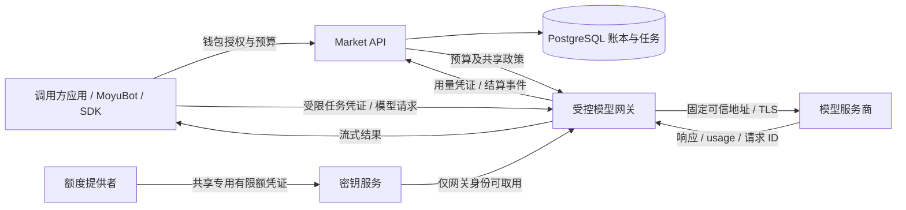
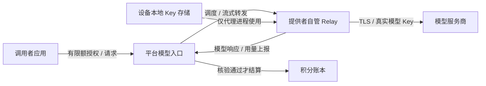

# MoyuChain / MoyuBot 模型额度互助市场开发文档

版本：0.3（开发设计稿，补充提供者自管代理）  
更新日期：2026-10-29  
状态：待实现。本文描述建议的第一版方案与后续阶段，不代表仓库已经具备这些功能。

## 1. 产品目标与已确认规则

用户把可共享的模型调用额度提供给其他用户，换取积分；以后使用积分调用其他人的模型额度。产品核心是模型 API 调用能力的共享与结算，MoyuBot 是调用客户端之一；普通聊天客户端、SDK 或其他 Agent 也可以接入。

本方案不依赖任务云电脑，不提供云主机租赁、远程桌面、脚本执行或第三方 Bot 托管。模型推理由上游模型服务商完成。原有 MoyuBot 云电脑功能是独立能力，不是本市场的使用前提。

提供者可以在自己的本地电脑或自有云主机上运行模型转发代理。这台设备只保管 Key、限制调用和连接上游，不运行调用者的程序。优先验证这种非托管模式；云主机是提供者可选的代理部署位置，不是平台提供的任务执行环境。平台托管模式保留为对照，不能默认上传用户 Key。

这里的“闲置 Token”主要指可使用的 API 余额、套餐额度或调用能力。Token 是用量单位，不是可以直接从一个供应商账户转账到另一个账户的资产。按量付费 Key 被调用后仍会产生真实费用，不能将其描述为已有的免费额度。

以下规则来自当前产品讨论：

- 不要求手机号、邮箱注册，但必须有可以证明归属的匿名身份。
- 本地轻量钱包保存身份密钥，展示积分、收入和支出。
- 积分只按模型实际计费用量结算，不收平台费或 Bot 服务费，也不计入任何计算主机费用。
- 不同模型、输入、输出和缓存采用不同价格。
- 调用者扣多少积分，额度提供者获得多少积分。
- 提供 Key 不直接奖励积分，只有额度被实际使用并核验后才获得积分。
- 价格优先来自可核验的公开接口或官方价目表。
- 真实模型 Key 不交给调用者及其应用；调用者只获得有限额的模型调用凭证。
- MoyuChain 作为结算网络名称保留，第一版采用服务端账本；是否建设真实区块链另行决定。

额度提供者仍承担上游 API 账单。现有设计中的身份 API、模型网关和积分账本需要轻量后端承载，可合并部署；它们处理请求转发与记账，不运行用户任务或模型推理。无需购买用于给用户干活的云电脑，但不能把它描述成完全不需要联网服务。

本文后续出现的“任务”仅指一组模型请求的预算会话，负责限额、取消及费用汇总，不代表平台代为执行代码、操作浏览器或管理远程电脑。

## 2. 第一版范围与阶段边界

### 2.1 第一版交付

1. 创建匿名身份、备份和恢复本地钱包。
2. 浏览可用模型、价格和共享状态，并选择要调用的模型。
3. 登记共享模型来源，配置模型名单、每日预算和并发限制；自管模式的 Key 只配置在代理设备上。
4. 查询可信模型价格、申请任务预算、调用共享模型。
5. 服务端核验用量，冻结、结算、释放积分。
6. 展示市场、共享状态、钱包流水及任务费用明细。
7. 对重试、断流、取消、断网和未知用量进行可靠处理。

第一版只要求调用方能够发送模型 API 请求。MoyuBot 用户可以给现有 Bot 绑定共享模型来源；其他客户端使用兼容 API 或 SDK。无需发布 Bot、配置云电脑或向平台上传可执行程序。

### 2.2 后续阶段

- 完善自管代理的生产计量与对账；在未完成可信核验前只进行受限、受邀试验，不把代理上报当作独立证明。
- Bot 模板发布与发现：可作为独立附加能力，不是额度周转的前提，也不参与第一版结算。
- 扩展更多模型服务商与 SDK，保持对调用客户端的独立性。
- 多运营方共同结算、账本摘要锚定、积分迁移至成熟链。

任务云电脑、第三方主机接单、远程 Bot 执行和执行沙箱均不在本方案范围内，也不是本市场后续阶段的默认计划；提供者自有云主机上的轻量代理属于模型转发功能。第一版不提供现金充值提现、积分自由转账、积分交易或独立公链。积分发行只用于明确记录的有限启动资金，规则见第 6 节。

## 3. 当前仓库与接入位置

当前仓库是 Electron + React 桌面端，使用 pnpm workspace；`packages/core` 提供 Agent、供应商适配、云主机和本地 JSON 存储。尚无市场后端、服务端身份系统或积分账本。

| 当前模块 | 已有能力 | 本方案需要的扩展 |
| --- | --- | --- |
| `apps/desktop/electron/app.ts` | 主进程装配、IPC、密钥服务 | 钱包签名、市场连接、共享授权与事件分发 |
| `apps/desktop/electron/preload.ts` | `window.moyu` 安全桥接 | 显式允许的钱包和市场方法，不暴露私钥读取接口 |
| `apps/desktop/src/lib/bridge.ts` | 渲染层类型契约 | 市场、钱包和共享状态的类型 |
| `packages/core/src/providers/types.ts` | `ChatProvider.chat()`、基础 usage | 请求级用量、价格版本、供应商请求 ID 和结算状态 |
| `packages/core/src/providers/openai.ts` | OpenAI 兼容流式调用 | 按服务商能力请求 usage，解析缓存与其他计费字段 |
| `packages/core/src/providers/anthropic.ts` | Anthropic 原生调用 | 规范化供应商特有计费用量 |
| `packages/core/src/providers/gemini.ts` | Gemini 原生调用 | 规范化供应商特有计费用量 |
| `packages/core/src/agent.ts`、`context.ts` | 多步 Agent、压缩与记忆 | 每次模型调用单独登记，后台压缩也计入预算 |
| `packages/core/src/store.ts` | 本地 JSON、`SecretBox` | 保存连接配置和只读缓存，不作为积分权威账本 |
| `packages/core/src/cloud.ts` | 本地账户下的共享云主机 | 与本市场独立，不接入共享模型计量、路由或结算 |

当前 `ChatOutcome.usage` 只有基础输入和输出字段；Agent 的 `message.usage = outcome.usage` 会被后续步骤覆盖，不能据此结算整段任务。必须新增请求级记录并逐笔汇总，包括压缩、恢复与重试产生的真实调用。

现有路线图“不内置代理、用户 Key 直连”需要明确新增一个可选共享模式例外。原有个人 Key 直连继续可用，只有用户主动开启共享时才接入模型网关。

建议新增目录，均为规划，不在本次文档工作中创建实现：

```text
apps/market-api/               身份、市场、预算、账本、查询 API
apps/model-gateway/            平台模型入口、来源路由、流式转发与用量证据采集
apps/provider-relay/           提供者自管代理；本地或自有云主机运行，保管模型 Key
packages/market-protocol/      无 Node 依赖的 DTO、签名规范和错误码
packages/market-client/        桌面主进程使用的市场 SDK
packages/pricing/              价格来源适配、归一化、积分计算
packages/ledger/               账本事务、冻结、结算、冲正
packages/identity/             主进程身份密钥、备份与签名
infra/market/                  PostgreSQL、部署和迁移配置
```

建议服务端沿用 TypeScript + Node.js，HTTP 框架采用 Fastify，数据库采用 PostgreSQL。首期 API、模型网关与价格同步可作为一个后端应用部署，并按模块隔离密钥权限；数据库可以独立部署或使用托管服务，不要求为每个模块单独购买服务器。平台不运行用户的 Agent 或工具。引入 Redis 或消息队列前先用 PostgreSQL 事务、outbox 和后台任务完成可靠闭环。

渲染层继续通过 IPC 调主进程。共享协议放在无运行时副作用的包中，渲染层不能运行时导入当前 `@moyu/core` 的 Node 模块。

## 4. 身份与本地钱包

### 4.1 钱包身份

第一版建议使用 Ed25519 身份密钥，钱包 ID 取创始公钥的 SHA-256 指纹并带版本前缀。该 ID 是稳定积分主体；后续更换授权密钥不改变钱包 ID。

- 私钥仅在 Electron 主进程生成、解密和使用。
- 复用系统密钥保护能力；不可安全加密时禁止开启共享钱包，不回退到明文存储。
- 渲染层只接收钱包 ID、公钥、余额、授权状态与签名结果。
- 身份密钥与模型凭证分开管理，互不替代。
- 本地显示的积分只是缓存，服务端账本才是余额权威来源。

Passkey 可以在后续作为设备授权方式接入。不能把 Ed25519 钱包和 WebAuthn 的不同算法、验证方式当成同一接口直接替换。

### 4.2 登录和签名

1. 客户端请求一次性 challenge。
2. 主进程签名，服务端验证钱包公钥、challenge 有效期和使用状态。
3. 服务端发放短期会话，绑定钱包与设备授权；会话不等于无限消费许可。
4. 发布共享、申请预算、修改预算上限等敏感操作仍需要结构化授权。

签名载荷必须包含 `protocolVersion`、`audience`、钱包 ID、HTTP 方法、路径、规范化请求体哈希、nonce 和过期时间。采用固定编码与 JSON 规范化规则，并提供跨端测试向量；不能直接对任意对象的默认序列化结果签名。

nonce 在服务端原子消费。相同幂等键、相同请求返回原结果；相同幂等键但不同请求体返回冲突，不能重复执行业务动作。

### 4.3 恢复与无人值守

- 首次启用提示导出加密恢复包，备份不包含模型 Key。
- 恢复后仍指向原钱包，不能重新领取启动补贴。
- 设备密钥撤销、会话撤销和根身份恢复需要单独实现。
- 未备份且所有授权密钥丢失时，平台无法仅凭昵称恢复积分归属。
- Bot、定时任务和 Telegram 只能使用用户事先批准的限额授权，不能访问根身份私钥。
- 授权至少限制任务/用途、模型集合、有效期、累计积分和并发；取消后禁止新模型请求，在途请求仍需核验用量。

## 5. 价格来源与积分换算

### 5.1 计价基准

建议固定 `1 USD 参考价值 = 1,000 积分`，作为模型额度之间的统一交换尺度。它不要求知道额度提供者的折扣、赠送额度或实际进货成本，也不承诺现金兑换。

同一已确认用量在同一价格版本下，调用者扣分与提供者收入完全一致。模型真实账单用于核验与风险控制，不能与参考价格混称为同一个金额。

### 5.2 价格来源策略

| 来源 | 使用方式 | 限制 |
| --- | --- | --- |
| OpenRouter Models API | 自动读取模型目录和 `pricing`，作为相应服务或明确标注的参考价 | 目录报价可能对应默认/首选提供商，不保证等于每个路由的真实账单 |
| 各服务商官方价格文档/API | 建立服务商专用适配器；网页变更需校验后发布 | 不假设存在统一价格 API；不要把 `/models` 列表当作价目表 |
| 经核验的人工价格表 | 服务商没有稳定接口时的受控后备 | 保留来源、生效时间和审核记录 |
| 用户自填价格、未知中转站 | 仅可作为待审核信息 | 第一版不据此自动结算 |

可核验来源：

- 模型目录接口：<https://openrouter.ai/api/v1/models>
- OpenRouter 价格字段与单位：<https://openrouter.ai/docs/guides/overview/models>
- OpenAI 官方价格：<https://developers.openai.com/api/docs/pricing>

上述接口及文档在 2026-10-29 的讨论中已实际读取。本文不固定最新模型名称或价格；实现时仍需校验最新字段、单位及来源使用规则。

第一版建议先接入 OpenRouter 下的少量文本模型，并逐个验证 streaming usage 和账单对账能力。这个范围是开发建议，不是产品已确定只支持该服务商。

### 5.3 归一化价格

内部价格唯一键至少包含：服务商、可信端点配置 ID、模型规范 ID/版本、服务档位、计费模式、模态及条件规则。不能仅用 `model = xxx` 匹配所有来源。

每个价格版本保存：

```text
priceVersionId, tariffKey, referenceCurrency=USD
inputRate, outputRate, cacheReadRate, cacheWriteRate
unit, conditionRules, sourceUrl, sourceHash
fetchedAt, effectiveAt, staleAfter, status
```

- OpenRouter 的 `prompt` / `completion` 等 Token 字段通常按 USD/Token；官方表格也可能按 USD/百万 Token，必须先统一单位。
- `overrides` 等长上下文或时段条件必须显式解析。无法理解的条件不能直接忽略后继续交易。
- 缓存命中、缓存写入、推理等字段按各服务商真实语义映射；属于总输入/输出的子集不能重复收费。
- 第一版只允许已适配的文本计费。图片、音频、搜索和付费工具能力未适配时在共享模式禁用，不静默按零成本处理。
- 同一请求的输入、输出、缓存使用同一价格快照；跨模型任务保存全部快照 ID。
- 条件价格按照每个请求的开始时间、实际上下文长度与服务档位计算，不能把价格目录拉取时的条件套用到全部后续请求。

同步建议每小时执行一次，使用超时、退避和缓存；目录拉取失败不清空历史价格，也不将缺失字段填为零。价格非负、单位明确、条件完整才可发布。价格骤变触发审核，建议初始阈值为 20%，后续按模型调整。

建议价格软过期时间为 24 小时：短暂来源故障可使用仍有效的版本，超时后禁止新预算。已冻结的任务继续按承诺的参考版本结算，在途供应商成本变化由提供者的共享风险政策约束。

### 5.4 金额精度与公式

用 `microcredit` 作为账本最小单位：

```text
1 积分 = 1,000,000 microcredits
1 USD 参考价值 = 1,000,000,000 microcredits

参考美元费用 = Σ(互不重复的实际计费用量 × 对应 USD 单价)
请求结算额 = ceil(参考美元费用 × 1,000,000,000) microcredits
任务总费用 = Σ(已确认请求结算额)
```

使用任意精度十进制计算和数据库 BIGINT/NUMERIC 存储，不使用 JavaScript 浮点数累积余额。JSON 中的大整数使用十进制字符串。每个请求只在最终合计时向上舍入一次，付款与收款共享同一个整数金额。

例如，假设输入 $1/百万 Token、输出 $5/百万 Token，无缓存：输入 10,000、输出 1,000，费用为 $0.015，对应 15 积分。调用者扣 15，额度提供者加 15。

## 6. 积分发行、预算与账本

### 6.1 启动与守恒

所有人从零积分开始会使市场无法产生第一笔交易。建议封闭试运行时建立有限的系统启动池，通过邀请人工分配，发行上限和每笔发放都入账。公开上线前另行确定额度和防滥用策略。

不采用“每生成一个钱包自动赠送积分”，因为免费生成身份会导致无限领取。不按上报 Token 铸造积分，也不通过自调用增加总积分。

普通用户余额必须非负。发行以独立系统发行账户为对手方、记录 `issuance` 分录及发行上限，不能直接修改用户余额。模型交易、冻结与释放均不改变已发行积分总量。

第一版不提供自动借贷、负余额或自动补贴坏账。运营方不承担无限 API 成本承诺。

### 6.2 账户与分录

服务端采用不可修改的复式账本，每笔交易的带符号分录合计为零。每个钱包至少有 `available` 与 `held` 子账户；余额表只是事务内维护的投影，可由分录重建。

例如预算 100 积分，实际消费 15：

| 动作 | 分录 |
| --- | --- |
| 冻结预算 | 调用者 available -100；调用者 held +100 |
| 结算模型调用 | 调用者 held -15；提供者 available +15 |
| 任务结束释放 | 调用者 held -85；调用者 available +85 |

唯一约束覆盖 `operationType + businessId`，同一次结算重复执行只产生一笔账。按固定顺序锁定相关账户，所有余额检查、分录和状态更新在同一 PostgreSQL 事务中完成。

不允许客户端提交新余额；不允许通过修改历史分录退款。退款使用关联原交易的冲正分录。提供者已花掉收入时，不能偷偷让其普通余额变负：进入争议处理；只有明确有余额的责任方/有限补偿池才能支付补偿。

### 6.3 双重预算

每次调用同时约束两端：

- 调用者：已冻结任务预算、授权有效期、模型范围和最大输出。
- 提供者：共享专用凭证、每日供应商费用上限、模型限额和并发数。

积分预算采用参考价；提供者成本预算采用其上游计费规则，两个账本不能混用。提供者缺乏可靠成本规则或费用硬限额时，不支持承诺精确的“最多花 X 美元”。

调用前为在途请求预留成本和积分额度；按明确 Token 上界及最大输出估算最坏费用，不能仅凭估算的平均输出放行。无法得到安全上界的计费功能暂不进入共享市场。计数在并发下原子更新，不能等待响应回来才扣减每日可用预算。

任务预算已从 available 转入 held，请求级预留只是在该任务 held 内划分可使用额度，不再次冻结用户积分。必须始终满足“任务已结算额 + 所有在途请求预留额 ≤ 任务批准预算”，防止并发请求重复使用同一笔冻结资金。任务结束时仅释放没有在途请求占用的余款。

## 7. 可信计量与 Key 保管方式

### 7.1 必须明确的信任边界

“Key 永不离开提供者机器”与“平台独立核验全部调用”无法只靠普通本地代理同时保证。提供者掌握机器管理权限，可以修改代理程序、伪造 usage、返回假模型结果；签名只能证明谁提交了记录，不能证明内容真实。

优先验证第 7.4 节的提供者自管代理，让 Key 留在提供者选择的设备上。第 7.2、7.3 节保留原托管网关方案作为对照；它们关于平台直接读取上游 usage 的信任条件，不自动适用于自管代理。是否开放自动生产结算仍由 M0 的计量验证决定。

若用户明确选择平台托管，提供者将共享专用、有限额且可撤销的子 Key/独立项目凭证交由平台网关保管。个人主 Key 不进入托管流程；服务商不支持所需隔离与限额能力时，暂不开放该来源的生产托管共享。

这是信任平台的托管模式。平台网关在调用时能接触明文模型凭证及请求内容；加密存储不能消除平台运行时的访问能力。界面必须明确说明托管边界，不能宣称“平台完全看不到 Key”。

### 7.2 对照方案：平台托管架构



网关只允许预登记的供应商域名、端口、接口和模型；拒绝客户端自定义 Host、Authorization 或可覆盖凭证的额外头。禁用任意重定向，防止 SSRF、DNS 重绑定及元数据地址访问。TLS 验证不允许被关闭。

凭证通过 TLS 登记到专门端点，密钥服务使用信封加密和受控密钥管理；普通业务表只保存 secret 引用。API 日志、请求追踪和错误上报禁止记录凭证。网关调用才解密，并限制网关对其他秘密的访问权限。

调用方应用拿到的是短期模型调用凭证，至少绑定钱包、预算会话、报价、模型集合、预算、有效期和服务端授权版本。它不能调用供应商的账单、密钥管理或其他未授权接口；任一额度提供者的真实 Key 都不出现在调用端。

### 7.3 托管模式用量核验

- 网关直接从可信上游连接读取最终 usage，保留供应商请求 ID 和必要响应头。
- 同时记录请求哈希、模型、上游配置 ID、价格版本、起止时间和规范化用量。
- 用量缺失不能按零收费，也不能把本地 Token 估算视为已核验账单。
- 能取得请求级账单时进行对账；账单凭证采用独立、最小权限，只读能力按来源适配。
- 只有汇总账单时只能做整体异常检测，不能声称已证明每个请求。无法解决断流计量的来源不进入生产共享名单。
- 正常 usage 与模型服务商账单仍可能有细节差异，供应商适配器必须说明支持的计费模式和已验证边界。

自管代理可接受受限试验额度，但不能仅凭代理签名放开积分结算。若未来有供应商签名用量证明、官方委托调用或经过验证的可信执行机制，再单独设计其验证协议。

### 7.4 优先验证：本地或自有云主机代理

两种部署使用相同的 Provider Relay 程序，仅运行位置不同：

| 部署 | Key 保存位置 | 在线条件 | 主要信任边界 |
| --- | --- | --- | --- |
| 本地电脑 | 提供者电脑的系统密钥存储 | 电脑和代理保持运行、联网；关机或休眠就停止新共享 | 提供者的设备、操作系统和代理程序 |
| 自有云主机 | 提供者控制的实例中的秘密存储 | 云实例和代理保持运行；提供者本机可关机 | 以上边界加云服务商及拥有实例管理权限的人 |
| 平台托管（对照） | 平台密钥服务 | 平台网关在线 | 平台运营方及其基础设施 |



代理主动建立经过双向身份验证的出站加密长连接，平台通过该连接下发受限模型请求；不要求家庭公网 IP、入站端口或端口映射。平台只登记代理公钥、来源 ID、模型名单、心跳和共享政策，模型 Key 不进入平台数据库、请求头或隧道控制消息。代理到模型服务商的 TLS 在代理设备终止，不能由平台截获该连接的 Authorization。

代理必须独立验证授权签名、请求 ID、请求体哈希、模型、最大输出、有效期、并发与预算，并持久化防重放记录。平台只能请求已允许的模型接口，不能远程执行 shell、读取任意文件、修改 Key、注入额外认证头或借调试接口访问秘密。签名预算并不保证调用有善意，因此本地政策和上游硬限额仍是必要边界。

代理默认使用独立有限额凭证。上游只有预算告警、没有硬限额时，不宣称泄漏后的最大损失已被限制。云主机不自动休眠，或休眠后在市场标记离线；不承诺实时接单同时保持关机。代理断线后立即停止新调度，已发送请求进入核验，不能直接全额释放冻结积分。

自管云实例由提供者持有管理权限，费用由提供者承担且不计入积分。若平台持有 root、SSH 或控制台权限、可任意更新代理二进制，平台仍可能读取 Key；因此不能仅因部署在“用户的云电脑”就宣称对平台保密。更新需要提供者可控的版本与签名校验，但恶意签名更新仍是软件供应链信任风险。

此架构首先解决 Key 的保管位置，不自动证明模型和 Token 用量。平台看到的是代理转发的响应，提供者可伪造 usage 或模型身份；调用者确认响应、双方签名、日志哈希和链上记录都不构成供应商计费证明。生产自动结算仍需可独立查询、绑定到具体请求且经过验证的供应商证据。没有该能力时，只能做明确披露对手方信任的受邀限额试验或模拟积分测试，不默认进入 `usage_verified`。

平台入口在上述转发方案中仍能读取请求与响应，提供者代理也能读取；这不是端到端内容保密方案。提供者自己的密码、文件和浏览器登录态无需交给调用者；但调用者发送的提示词仍涉及对提供者及模型服务商的隐私信任。

## 8. 请求、任务与失败处理

### 8.1 正常流程

1. 用户在 MoyuBot 或其他客户端选择目标模型、最大积分预算，界面展示固定价格版本。
2. 服务端检查钱包余额、共享来源和授权，冻结预算，创建任务。
3. 客户端每次模型调用前申请请求 ID 和在途额度；若客户端是 Agent，压缩与恢复调用也走相同入口。
4. 网关先持久化请求意图并占用预算，再通过自管 Relay 或明确启用的托管网关调用模型，向调用者转发流式结果。
5. 采集最终 usage 和证据；独立核验通过后才生成已核验凭证、原子提交积分转移。自管代理上报默认是未核验数据，不能因收到签名就直接进入 `usage_verified`。
6. 客户端可在预算内继续请求；每个请求独立结算，预算会话结束释放未花费额度。
7. 多提供者参与时，按每个请求的实际提供者分别入账。

建议请求状态：

```text
created -> reserved -> dispatched -> streaming -> usage_verified -> settled
                         |              |
                         +--------------+-> usage_pending -> usage_verified

reserved -> failed_unbilled -> released
dispatched -> failed_unbilled（仅已确认上游未计费时）
usage_pending -> disputed（停止新请求，进入对账/人工处理）
```

预算会话状态与资金状态分开：会话可以已停止接受新请求，但仍有 `usage_pending` 的模型请求。UI 必须显示“已停止新调用，用量核验中”，不能显示成已全额退款。

### 8.2 处理规则

| 场景 | 处理 |
| --- | --- |
| 未发上游前取消、鉴权失败且确认未计费 | 释放该请求预留，任务结束后释放余款 |
| 用户取消、任务失败，但已有可信用量 | 已发生的模型费用照常结算，释放未发生部分 |
| SSE 断开、超时、没有最终 usage | 保持该请求预留，进入对账；停止继续消耗该任务预算 |
| 请求是否到达上游不确定 | 不盲目重试，先查请求状态或账单 |
| 上游支持并验证了幂等调用 | 用同一上游幂等标识恢复，确认不会重复计费 |
| 主动发起第二次真实调用 | 新请求 ID，并明确占用第二次预算；不能作为原请求无成本重放 |
| 提供者额度用完、Key 撤销、离线 | 停止该来源新请求；在途请求对账后结算 |
| 提供者离线后更换来源 | 仅对尚未发出的请求路由，遵守用户模型/价格/数据授权 |
| 实际费用超过已批准预算 | 不透支调用者；暂停新调用并调查上界计算，差额进入有明确责任的异常处理 |

建议 `usage_pending` 超过 5 分钟开始主动对账，超过 24 小时转争议处理。时间阈值可配置；超时不自动认定免费、不自动给提供者发满额积分。封闭测试中无法核验的请求保持待处理并限制该来源，直到明确有记录的解决方案。

网关持久化与上游调用不存在跨系统原子事务。写入 `dispatched` 后崩溃属于潜在已计费状态；用持久化意图、outbox、供应商幂等能力和对账恢复，不能用“数据库事务”假装实现上游恰好一次执行。

## 9. 服务端数据模型

建议核心表如下，所有时间存 UTC，客户端按用户本地时区展示。

| 表 | 关键字段与约束 |
| --- | --- |
| `wallets` | wallet_id、genesis_public_key、status、created_at |
| `wallet_keys` | wallet_id、public_key、scope、expires_at、revoked_at；支持设备授权 |
| `auth_challenges` | challenge_hash、wallet_id、expires_at、consumed_at；nonce 唯一 |
| `sessions` | wallet_id、device_key_id、token_hash、expires_at、revoked_at |
| `resource_shares` | owner_wallet_id、provider_profile_id、custody_mode、relay_id、model_allowlist、预算与并发、status；secret_ref 仅明确启用的托管模式可有值 |
| `provider_relays` | owner_wallet_id、relay_public_key、allowed_profiles、policy_version、last_heartbeat、status；不保存模型 Key |
| `price_versions` | tariff_key、rates、conditions、source_hash、effective_at、stale_after；发布后不可改 |
| `task_quotes` | wallet_id、model_allowlist、price_version_ids、max_microcredits、expires_at、body_hash |
| `tasks` / `task_authorizations` | payer_wallet_id、quote_id、session_status、funding_status、授权与撤销版本；仅模型预算会话 |
| `model_requests` | task_id、share_id、request_id、upstream_request_id、预留额、状态、价格版本 |
| `usage_receipts` | model_request_id、规范化用量、证据来源、verification_status、receipt_hash |
| `ledger_accounts` | wallet_id、bucket、balance_microcredits、version；普通账户余额非负 |
| `ledger_transactions` / `ledger_entries` | transaction_type、business_id、account_id、signed_amount；唯一业务键、分录合计为零 |
| `idempotency_keys` | wallet_id、route、key、request_hash、response_ref、expires_at；组合唯一 |
| `outbox_events` | event_id、event_type、payload、attempts、next_attempt_at、published_at |
| `audit_events` / `disputes` | 操作主体、资源 ID、前后状态摘要、关联请求、解决分录，不含秘密 |

价格版本、签名凭证、业务状态、账本交易必须能通过 `task_id` / `request_id` 串联。日志不能作为唯一的财务数据源。

普通应用数据库角色不能 UPDATE/DELETE 已提交账本分录；入账通过受控服务或数据库过程校验。数据库管理员仍具有高权限，因此还需独立备份、访问审计和每日账本摘要；不可向用户宣称中心化账本无法被运营方修改。

## 10. API 与桌面契约

以下是拟定接口，不代表已有可用服务。全部采用版本化 `/v1`，修改操作必须校验身份、资源归属及幂等键。

| 方法与路径 | 作用 |
| --- | --- |
| `POST /v1/auth/challenges`、`POST /v1/auth/verify` | 获取 challenge、验证身份 |
| `GET /v1/wallet`、`GET /v1/wallet/transactions` | 查询余额与分页流水 |
| `GET /v1/market/models` | 返回已适配模型、可用来源、参考价格和有效期 |
| `POST /v1/shares`、`PATCH /v1/shares/{id}` | 登记来源及共享政策；自管模式禁止提交模型 Key |
| `POST /v1/relays`、`POST /v1/relays/{id}/revoke` | 注册代理公钥及撤销代理连接，不登记模型 Key |
| `POST /v1/shares/{id}/pause` | 停止新调用、撤销相关授权 |
| `POST /v1/quotes` | 创建短期报价，暂不冻结资金 |
| `POST /v1/tasks` | 消费有效报价、原子冻结预算、返回任务凭证 |
| `POST /v1/tasks/{id}/cancel` | 停止后续请求，启动在途请求结算 |
| `GET /v1/tasks/{id}`、`GET /v1/tasks/{id}/events` | 状态、SSE 事件与重连 |
| `POST /v1/gateway/chat/completions` | 第一版 OpenAI 兼容模型入口；仅任务凭证可调用 |
| `GET /v1/requests/{id}` | 查询请求与结算状态，不通过重发模型请求恢复 UI |

报价必须有过期时间和请求体哈希；创建任务时已过期则要求重新报价。任务获得的价格快照可用于预算内后续调用，但任务本身仍有有效期。

对外错误至少包含 `code`、`message`、`requestId`、`retryable`；区分 `insufficient_credits`、`price_stale`、`unsupported_billing`、`share_unavailable`、`budget_exceeded`、`usage_pending`、`idempotency_conflict`。不能把所有 5xx 标记成可以重发模型请求。

SSE 采用持久事件 ID，并支持 `Last-Event-ID` 或等价游标恢复。重复事件由客户端按 ID 去重；客户端重连不触发第二次结算。

拟新增 IPC：`wallet:status`、`wallet:backup`、`wallet:restore`、`market:listModels`、`share:configure`、`share:pause`、`market:quote`、`market:authorize`、`market:cancel`。不提供 `wallet:getPrivateKey` 或任意文本盲签接口。

兼容 API 以平台网关 URL 为 Base URL，Authorization 使用预算授权下的短期调用凭证。首期实现模型列表、聊天补全、SSE、工具调用的模型消息和 usage 返回；工具本身由调用客户端执行。不能为了兼容普通客户端而发放可无限消费的长期凭证，也不能把提供者的 Key 返回给客户端。

## 11. 桌面交互

### 11.1 模型市场与客户端

- 市场卡片展示模型名称、服务商、支持能力、输入/输出/缓存参考价格和可用状态，不展示真实 Key。
- “使用此模型”创建有限额的预算授权；MoyuBot 可以将其绑定到现有 Bot，普通聊天客户端不要求创建 Bot。
- “共享我的额度”登记专用凭证与共享政策，随后由平台在允许范围内路由请求。
- SDK/API 接入页提供网关地址和受限凭证的配置方式，说明模型能力兼容范围。
- 共享只涉及模型请求。聊天历史、长期记忆和文件仍由调用方应用管理，仅调用方明确放进请求的内容会发送给模型服务。

### 11.2 共享额度

用户主动开启共享，选择本地、自有云主机或明确同意的平台托管方式，配置允许模型、每日预算、并发、有效期和暂停策略。自管模式在代理设备配置专用模型凭证，不上传给平台。界面同时展示在线条件、计量核验等级、积分参考价格与“上游费用由你的模型账户承担”。

共享暂停或撤销要立即阻止新请求；不能保证已发送的请求不再计费。不得默认把用户现有所有 Key 加入共享。

### 11.3 钱包与消费

- 展示可用积分、冻结积分和待核验请求。
- 收入支出可以按模型、来源、日期和预算会话查询，点开能看到 Token 分类和价格版本；Bot 标签只是可选客户端元数据。
- 开始调用时展示最大预算、模型范围及数据经过的网关和模型服务商。
- 常用客户端或 Bot 可设置有限的自动授权；超过范围或预算必须再次授权。
- 取消任务显示“停止后续调用”，同时解释已产生模型费用仍计入结算。
- API Key 的登记是设置页中的明确操作，绝不出现在聊天消息或模型上下文中。

## 12. 模型调用、隐私与安全

本市场只代理模型 API，请求调度的对象是模型来源，不是远程主机。无需任务虚拟机、远程浏览器、文件挂载或执行沙箱，也不向调用者分配额度提供者的电脑。

模型请求会经过平台入口、提供者自管代理（如使用）与模型服务商，需在授权前说明。提供者在自管代理上能接触请求正文；托管模式下也可能从供应商账户看到请求元数据，甚至取决于服务商设置看到内容日志。不能承诺使用别人的额度时对额度主人完全匿名或完全保密，接入来源时必须核实其日志与数据可见范围。

默认不在账本保存提示词和输出正文，流式转发和对账只保留必要的请求 ID、计费用量与证据摘要。排查问题需要内容日志时，必须单独授权，并设置访问权限与短期保留策略。供应商自身的数据保留规则单独说明。

核心安全要求：

- 凭证按共享来源独立管理，支持轮换、暂停、撤销和最小权限。
- 请求只能到固定可信模型端点，限制模型、并发、最大输出、时长与费用。
- 按钱包与请求隔离会话状态、流式响应及缓存，不将一个用户的内容返回给另一个用户。
- 调用方不能读取、导出或覆盖提供者 Key，也不能借模型接口调用上游管理功能。
- 上游错误和调试日志统一脱敏，备份与监控不收集 Authorization 或明文凭证。
- 工具调用仅作为模型输出返回；平台不执行其中的代码或操作，工具授权由客户端自己处理。

模型输入与输出都视为不可信数据，不能通过提示词诱导修改计价、共享设置、身份授权或网关路由。平台操作由结构化 IPC/API 处理，模型没有账本写权限。

来源接入还需核实供应商是否允许相应的第三方调用/额度共享。只将满足能力、计量和使用条件的来源列入支持名单，不以“用户填了 Key”代替接入验证。

## 13. 实施顺序与验收标准

### M0：用量与来源验证

- 选定一个服务商和少量文本模型，验证正常、工具调用、缓存、长上下文及取消后的计费语义。
- 验证共享专用凭证的权限、硬限额、撤销效果及请求级对账能力。
- 优先验证本地及自有云主机 Relay 的上线、断线、独立策略和防重放；验证平台不持有模型 Key。
- 明确每种模式的计量证据；未解决自管代理核验前只进行受限试验，不承诺与直接连接可信上游同等的计量保证。
- 输出支持矩阵；不能可靠计量的模型暂不支持积分交易。

验收：一条实际请求能对应可信上游用量、价格版本和可解释的成本；断流后的处理有验证依据。

### M1：身份与账本

- 完成钱包生成、加密备份恢复、challenge、会话、限额授权。
- 完成发行上限、启动池、冻结、结算、释放、冲正和重放防护。
- 服务端余额可通过分录重建；账户并发操作不超支。

验收：在无真实模型费用的测试环境，两个钱包完成“冻结 100、结算 15、释放 85”，重试不重复扣款，全部分录合计为零。

### M2：价格、模型入口与提供者代理

- 完成价格拉取、归一化、校验、版本发布和过期策略。
- 完成代理公钥登记、出站长连接、设备本地 Key 配置、受限调用、逐请求证据、outbox 和崩溃恢复；托管来源需另行明确启用。
- 将正常结算与未知用量对账接入账本，验证两端预算。

验收：两名受邀用户完成一笔真实小额交易；调用者扣分等于提供者入账，真实模型调用与结算一一关联。

### M3：模型市场与客户端闭环

- 完成模型发现、来源匹配、授权、共享设置、钱包与费用明细。
- 提供兼容 API 和最小 SDK 接入；MoyuBot 的 Agent、上下文压缩、定时任务和 Telegram 全部受同一预算约束。
- 保持个人 Key 直连流程和原有本地功能可用。

验收：A 贡献额度获得积分，再使用积分调用 B 的模型；普通客户端和 MoyuBot 都能完成调用，无需配置云电脑，提供者 Key 不暴露给调用者。

### M4：封闭试运行

- 完成安全检查、恢复演练、预算压测、对账和争议处理。
- 只邀请有限提供者，采用有总上限的启动积分池。
- 观察请求成功率、待核验金额、账本差异、密钥撤销延迟和来源费用异常。

验收：所有资金异常都有可追踪状态，无未解释的账本差异；在预算控制或计量失效时自动停止相关来源的新请求。

## 14. 实现时必须覆盖的测试

这是后续开发验收清单，本次只编写文档，不引入测试实现。

| 类别 | 关键场景 |
| --- | --- |
| 身份 | 错误签名、过期 challenge、nonce 重放、设备撤销、恢复后身份不变 |
| 精度 | 每 Token/每百万单位转换、缓存子集、条件价格、极小金额、BIGINT 序列化 |
| 账本 | 并发冻结、重复结算、事务回滚、余额重建、发行上限、无余额冲正 |
| 预算 | 并发请求预留、最大输出、后台压缩、每日限额、授权撤销、任务到期 |
| 网关与代理 | 未知上游、恶意 Header、重定向/SSRF、Key 泄漏、命令/文件接口不可用、断线重连、签名重放、超时和取消 |
| 核验证据 | 自管代理伪造 usage、伪造模型身份、重复请求证据不得直接获得已核验结算 |
| 恢复 | 上游返回后进程崩溃、未写 usage 就断流、outbox 重复投递、账单延迟 |
| 市场与客户端 | 模型来源匹配、受限凭证、兼容 API 的流式与工具消息、越权修改他人共享、跨用户内容隔离 |
| 回归 | 个人 Key 直连、原有 Agent、上下文与记忆、Telegram；模型共享不触发云主机生命周期 |

实现完成后按改动运行相关检查，沿用仓库现有 `pnpm typecheck`、`pnpm build`、`pnpm smoke`、`pnpm test:conversations` 等流程，并新增针对账本与网关的独立检查。测试默认使用假服务和隔离数据库，真实费用验证单独限额执行。

## 15. MoyuChain 的后续演进

第一版应在产品和文档中明确标注“服务端积分账本”，不将名称当成已部署区块链的证明。

当多个独立运营方确实需要共同验证结算时，再评估：

1. 对每日账本与凭证生成摘要或 Merkle root，支持用户核验记录包含关系。
2. 将摘要定期锚定到成熟链，降低事后重写历史的隐蔽性。
3. 设计余额快照、用户认领、积分迁移与防双花，再考虑链上持有。
4. 只有独立验证者、共识需求和运维投入明确后，再评估专用链。

上链不能证明真实模型、Token 数、回答质量或任务完成。只上链必要的余额/结算信息与摘要，不能上链 API Key、恢复密钥、用户文件、提示词或浏览器登录态。摘要公开也需要防止通过小样本猜测敏感内容。

## 16. 下一步需要落实的产品决定

这些事项不阻碍本文作为开发依据，但进入对应实现前需要确定并记录：

| 决定 | 本文建议默认值 |
| --- | --- |
| 首个模型来源 | OpenRouter 少量已验证文本模型 |
| 参考计价比例 | 1 USD 参考价值 = 1,000 积分 |
| Key 保管方式 | 优先验证提供者自管 Relay，本地或自有云主机部署；平台托管仅为明确同意后的对照方案 |
| 可信计量方案 | 按模式验证独立供应商证据；未解决核验前不开放自管代理生产自动结算 |
| 调用方 | MoyuBot、普通聊天客户端与 SDK；不依赖 Bot 发布或云电脑 |
| 启动积分 | 有发行总上限的受邀分配，不按新钱包自动赠送 |
| 首批共享用户 | 封闭邀请，先验证完整周转与风险边界 |
| 区块链 | 先不部署，保留 MoyuChain 名称和迁移设计 |

本文不承诺所有供应商已支持上述模式。M0 的来源能力验证是开放真实共享之前的前置条件。
