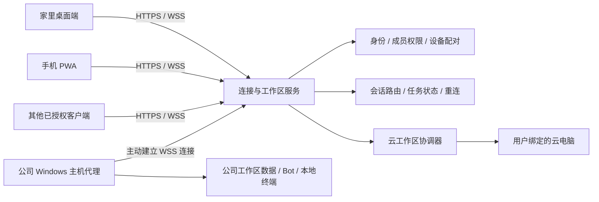

# 工作区、电脑共享与多端连接

更新日期：2026-10-29  
状态：本地 Windows 与云电脑工作区已实现首版；跨设备连接、远程共享和 PWA 仍为后续设计。

## 当前可用范围

- 左侧切换「本地 / 云电脑」。本版各提供一个工作区，各自保存 Bot、固定对话、群聊、记忆、定时任务、分组与用量视图。
- 同一工作区的 Bot 共用对应电脑；工具执行根据 Bot 所属工作区绑定，切换界面不会改变后台任务的执行位置。
- 本地支持 Windows PowerShell、读取和写入工作区文件，在设置的「本地电脑」中选择工作目录。新建本地 Bot 默认执行前确认；命令使用当前 Windows 用户权限，并非系统沙箱。
- 顶部终端按钮或右侧「打开终端」打开底部命令面板。两边分别保留本次启动期间的命令记录，支持停止当前命令；云电脑休眠时展示唤醒入口。
- 当前面板逐条执行命令，完成后显示输出。每条命令从工作目录重新开始，不保留 `cd`、变量或交互进程状态，不支持交互式 TUI；完整 ConPTY / PTY 与流式输出留待后续。
- 旧 Bot 与历史归入原云电脑工作区，首次迁移前在数据目录创建 `backup-before-workspaces`，模型供应商和密钥配置沿用。供应商配置是本机用户级设置，本版没有上传数据到连接服务。
- 本地工作区定时任务需要 MoyuBot 和本机保持运行。云电脑工作区的聊天与调度仍由桌面端保存、运行，并非服务器托管协调器。

下文涉及多工作区创建、多用户权限、远程主机、服务器托管和 PWA 的内容为后续目标。

## 1. 产品范围

MoyuBot 面向多用户发布。工作区和异地连接不能依赖开发者个人的电脑、域名或单用户服务器配置。

已确认需求：

- 三类工作区：本地电脑、云电脑、远程共享电脑，先支持 Windows 主机。
- 同一工作区里的 Bot 共用对应电脑；不同工作区的 Bot、聊天、记忆、任务和文件边界分开。
- 右侧「电脑」展示当前工作区对应设备，底部可打开该设备的终端。
- 云电脑休眠、共享电脑离线需要真实呈现状态。
- 桌面与手机通过网页 PWA 连接同一工作区，异地访问公司和家里的电脑。
- 产品提供面向普通用户的连接流程；保留自部署能力。开发环境具备 Linux、Docker 和可配置子域名。

下述账户方式、授权角色和服务组件是建议设计，具体登录方案与公网域名尚未确定。模型额度互助市场见 `MOYUCHAIN-DEVELOPMENT.md`，它与工作区执行、设备共享及数据同步分别建设，不能把市场凭证当作电脑控制权限。

## 2. 用户看到的工作区

「类型」说明使用哪种电脑；「工作区」是独立的数据和权限容器，不是三份全局开关。用户可以有多个本地目录、多个云电脑或多台共享电脑。

| 类型 | 执行位置 | Bot 与数据 | 终端与状态 |
| --- | --- | --- | --- |
| 本地 | 当前绑定的 Windows 主机 | 当前工作区独立保存；离线可使用已配置的功能 | 本地 PowerShell；显示目录与设备名称 |
| 云电脑 | 绑定的云主机 | 工作区服务保存聊天与任务，文件留在该云主机或工作区文件存储 | 云主机终端；休眠时显示休眠，可手动唤醒 |
| 共享电脑 | 用户配对的另一台主机，例如公司电脑 | 属于该主机上被授权的工作区 | 远端 PowerShell；显示在线、离线、连接中 |

一个本地工作区启用远程访问后，仍是同一个工作区。家里电脑和手机上以「共享电脑」入口访问它，不另外复制一套 Bot 和聊天记录。「我的设备之间访问」与「邀请其他人」是两个不同操作，开启远程访问不自动发布给其他用户。

共享执行环境意味着 Bot 能看到同一目录和运行环境，不意味着每个命令都必须全局串行。终端使用独立会话；任务有并发上限；高风险的共享资源修改需要锁或排队。聊天可以并行，避免一个终端长任务阻塞所有 Bot。

## 3. 默认流程

### 普通用户

1. 安装桌面端后可以先创建本地工作区，不强制联网注册才能使用本地能力。
2. 需要跨设备时登录连接服务，设备生成自己的身份密钥并登记；用户明确开启该工作区的远程访问。
3. 在第二台电脑或 PWA 登录同一身份，选择有权限的工作区。
4. 在公司电脑上完成一次配对确认；授权可随时撤销，可看到哪些设备或用户拥有访问权。
5. 要邀请同事时，额外创建有期限的邀请并选择权限，不把自己的设备凭证发给对方。

普通用户无需填写服务器 IP、购买域名或设置端口转发。具体登录可以采用成熟 OIDC 服务，也可以设计可恢复的密钥身份；多用户隔离必须基于可验证的主体，不能依赖客户端传入一个 userId。

### 自部署用户

- 管理员部署同一套服务到自己的 Linux / Docker 环境，为 HTTPS 子域名配置入口。
- 客户端在高级设置中更换服务地址；一个部署可容纳多个用户和工作区，不要求每人部署一个服务器。
- 绑定关系包含服务实例标识，切换服务不会自动把原服务的数据、密钥或授权复制过去。
- 官方服务与自部署保持相同协议，通过协议版本协商处理客户端兼容性。

## 4. 服务与主机职责

连接服务负责身份、设备在线状态、授权、连接路由和可靠投递。工作区协调器负责运行 Bot、保存消息、安排任务和关联终端。它可以在本地主机上，也可以在服务器上托管云工作区；不是所有用户共用一个可执行任意命令的服务器进程。

Windows 主机代理主动连接公网服务。家里电脑和手机也主动连接，因此通常不需要家庭宽带或公司网络提供公网 IP、开放入站端口。代理支持重连与心跳。网络禁止相关出站连接、要求代理或公司不允许远程控制时，连接可能不可用，应说明原因，不能承诺任意网络都能打通。

第一版可使用服务端中继以降低网络复杂度，后续按需增加直连优化。TLS 保护传输，但服务端中继不等于端到端加密；若提供端到端加密，要实现设备密钥验证、会话加密、撤销与恢复后才能这样宣传。

## 5. 数据如何互通

### 每个工作区一个写入权威

同一工作区的多台客户端访问同一个协调器，由协调器决定持久化与执行。不要在家里电脑、公司电脑、手机之间分别运行可修改同一记录的独立 JSON 数据库，再靠整份文件互相覆盖。

- 本地/共享主机工作区：默认该主机是数据与执行权威；远程客户端通过连接服务访问它。
- 云工作区：服务端协调器是聊天与任务权威，云电脑是执行环境，二者生命周期独立。云电脑休眠时仍可看历史记录，执行命令需唤醒。
- 私有本地工作区：不启用远程访问时数据保留在本机，不依赖连接服务。

这样公司电脑与家里电脑的数据互通主要是「访问同一份工作区数据」，不是偷偷把公司的全部文件同步到家里。

### 实时与重连

- 消息、任务、审批和执行状态作为有顺序号的事件发送；客户端保留接收游标，断线后补取。
- 发消息、创建任务、运行命令使用唯一请求 ID。重试同一个请求不得启动第二次执行。
- 事件可以重复投递，业务以幂等实现一次生效，不能把网络链路描述为保证 exactly-once。
- 记录带版本号，并发改 Bot 配置时检测版本冲突；终端流带会话 ID 与序号。
- 大文件不放入实时事件中，用带权限检查的上传、下载接口与文件引用。
- 文件默认位于执行主机；下载、备份、云端副本是显式功能，不默认镜像整个磁盘。
- 搜索、记忆、用量和任务查询始终限定工作区，跨工作区汇总须显式选择范围。

### 离线边界

- 共享主机离线时不能远程运行它的命令。客户端显示离线，不改为在访问者电脑执行。
- 初版不默认排队未知时长的远程命令，避免主机几天后上线突然执行；后续队列需可见、可取消、带有效期。
- 初版 PWA 不缓存敏感聊天和文件，断网展示连接状态。若以后支持离线历史，需要专门的设备存储与清除选项。
- PWA 被手机系统挂起后不能保证常驻 WSS；执行由主机或云协调器继续，恢复页面后补取状态。通知需要独立的 Web Push 和用户授权。
- 公司电脑上的定时任务在主机在线且代理运行时执行；服务端不能在该主机关机后替它操作文件。

## 6. 多用户隔离

数据模型至少包含：

| 实体 | 主要字段与约束 |
| --- | --- |
| Principal | 可验证的用户身份，不依赖客户端自报 |
| ServiceInstance | 官方或自部署服务的身份与协议版本 |
| Device | 所有人、设备公钥、名称、在线心跳、撤销时间 |
| Workspace | 所有人、类型、协调器、执行设备、根目录、状态 |
| WorkspaceMember | 用户、工作区、角色、授权范围与有效期 |
| Bot / Conversation / Memory / Schedule / Usage | 不可缺少 workspaceId |
| Execution / TerminalSession | workspaceId、deviceId、发起者、权限、请求幂等 ID |
| Artifact / Event | workspaceId、归属、对象 ID、版本或事件序号 |

成员权限建议先分所有者、执行者、只读者。只读者不能打开交互终端、批准命令、调用文件写入或间接启动有副作用的 Bot 工具；服务端、协调器与主机代理都必须校验对应权限。API 路径、实时订阅、搜索、下载和后台任务同样校验，不能只隐藏 UI 按钮。

设备配对码短期有效、单次使用，需要主机端确认。访问凭证不能复用模型 API Key。撤销设备、成员或工作区访问权后应关闭关联会话、阻止新操作，并定义对在途任务的取消策略；已在主机运行的进程不能仅靠断开网页连接来保证终止。

普通模式的模型 Key 留在运行模型请求的受信协调器/主机，不能自动上传给官方服务。云端托管需要用户明确配置并使用加密存储，访问者拿不到原始 Key。主机代理按工作区目录与能力授权访问文件；Windows 本机执行继承代理用户的系统权限，不等于沙箱隔离，需清楚表达这一边界。

## 7. 终端与桌面 UI

- 左侧增加工作区选择器，显示类型图标、名称、设备状态；切换后 Bot 列表、置顶、隐藏项、分组、群聊和搜索一起切换。
- 每个工作区记住自己的选中 Bot、当前对话、终端开关与布局，不把上一工作区的消息短暂显示出来。
- 右侧「电脑」显示工作区对应电脑：本地 Windows、云主机、远程共享 Windows。
- 点击「打开终端」在聊天底部显示可折叠面板，展示设备名、根目录、连接状态、会话切换与关闭。
- 真实交互终端需要 Windows ConPTY / PTY 支持，具有 stdin、resize、输出流、停止与会话生命周期。现有执行单条命令的表单不能直接称为完整终端。
- 云电脑休眠时终端展示「电脑休眠中」与唤醒入口；失联和休眠分开，不能用一张休眠图遮住连接错误。
- 输入命令前显示当前工作区与设备，避免切换后把命令发给错误的电脑。
- PWA 使用相同协议和设计变量，移动端将侧栏、详情和终端做成切换面板；不要求复刻桌面三栏宽度。

## 8. 现有仓库迁移

迁移前 `Store` 只有一套 Bot 数据，`AgentRuntime`、工具、图片产物、系统提示词和 IPC 都直接绑定 `CloudHost`。本阶段已增加工作区标识与 `LocalHost` 执行适配器，兼容原 `cloud_*` 工具名，实际命令根据 Bot 所属工作区路由。下表同时包含已完成的本地/云电脑拆分和后续远程化方向。

| 模块 | 修改方向 |
| --- | --- |
| `packages/core/src/types.ts` | 增加工作区、设备、执行环境和协议类型；浏览器共享协议移到无 Node 依赖包 |
| `packages/core/src/store.ts` | 按 workspaceId 隔离存储或独立 Store；迁移旧目录，保留记录与原 ID |
| `packages/core/src/cloud.ts` | 作为 CloudComputer 适配器保留，不能承担本地执行 |
| `packages/core/src/agent.ts` | 按 Bot 所属工作区注入执行器与文件根目录；运行期间绑定快照 |
| `packages/core/src/tools.ts` | 从 cloud_* 迁移为通用电脑工具；旧名称提供兼容映射，不改变旧记录 |
| `apps/desktop/electron/app.ts` | 工作区级 API、事件订阅、终端会话；不通过一个全局 activeWorkspace 改写后台任务目标 |
| `apps/desktop/src/lib/bridge.ts` | Electron IPC 和 Web HTTPS/WSS 两种实现，共用业务接口 |
| `apps/desktop/src/state.tsx` | 切换时取消旧请求/订阅，用工作区 ID 检查迟到响应；各工作区独立状态 |
| 桌面组件与页面 | 工作区选择器、设备管理、底部终端、范围化搜索与用量 |

迁移原则：

1. 升级前创建可恢复备份；已有 Bot、固定对话、引用、群聊、记忆、任务、用量和产物归入原云工作区。
2. 本地工作区使用新的 ID 与目录，不移动或复制旧 Bot，用户可单独创建 Bot 或导入模板。
3. `workspaceId` 必须贯穿请求、事件、任务、审批、文件 URL。跨工作区群聊与文件引用默认拒绝。
4. 执行任务使用启动时绑定的执行器；切换 UI 工作区不能把正在运行的任务转移到另一台电脑。
5. 定时任务由所属工作区协调器领取，以租约/幂等 ID 防止多台在线设备重复触发。
6. 供应商模板可作为用户级配置；密钥共享须明确作用域，不在工作区之间默认扩散。

## 9. 分阶段交付

### A：本地与云工作区（首版已完成）

已实现 Bot 与数据范围隔离、迁移备份、执行器接口、Windows 本地命令/文件工具、工作区选择器、底部命令面板和云端休眠状态。通过核心回归及桌面双工作区验证，不需要公网服务。完整交互终端、多工作区创建与跨设备同步不在本次交付范围。

### B：多用户连接服务与 Windows 共享主机

实现身份、设备配对、成员权限、主机出站连接、远程工作区 API、任务与事件幂等、断线重连、撤销和审计。交付 Docker Compose、HTTPS 反向代理模板与数据卷备份说明。官方服务与自部署共用协议。

### C：PWA

实现 Web bridge、响应式布局、manifest、图标、Service Worker 与设备会话管理。Service Worker 只缓存静态应用资源，API、终端流、认证和私有文件绕过缓存。手机用浏览器访问并可安装到主屏幕。

### D：正式发布验证

- 至少两个用户、多个工作区，验证越权读取、写入、订阅、文件下载与终端全部被拒绝。
- 两台 Windows 主机与一部手机通过不同网络联测，验证代理重连和设备撤销。
- Bot 并行运行时切换工作区，证明命令、文件、审批与产物不会串到其他设备。
- 验证云电脑休眠/唤醒、主机离线、连接服务重启、重复消息与任务重试。
- 验证旧数据迁移与回滚，不用真实用户数据代替隔离测试数据。
- 终端输入输出设置流量上限和背压，服务对用户、设备、工作区实施配额，避免一个会话拖垮所有用户。
- 发布前补充服务运维、数据库恢复、凭证轮换、隐私说明与升级兼容策略。

后续阶段按 B、C、D 推进，目前不具备跨设备对外服务能力。部署阶段再确认正式子域名、TLS、部署方式与凭证配置。
